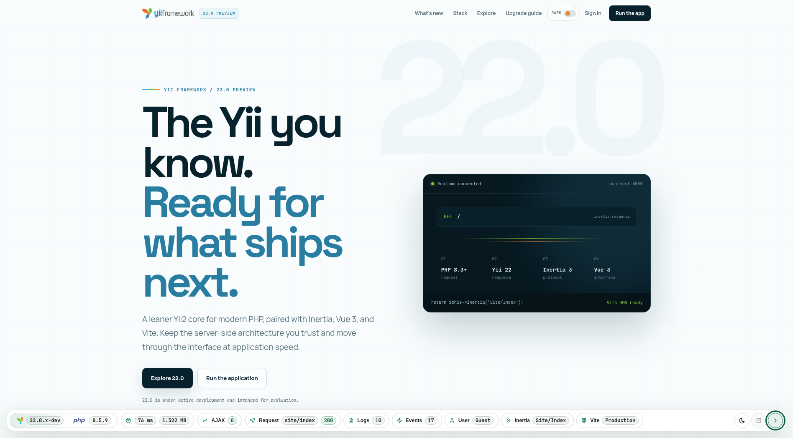
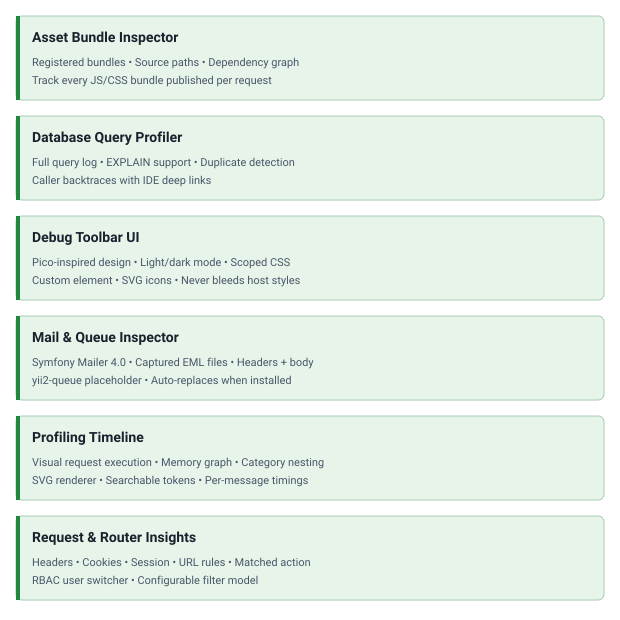

<!-- markdownlint-disable MD041 -->
<p align="center">
    <picture>
        <source media="(prefers-color-scheme: dark)" srcset="https://www.yiiframework.com/image/design/logo/yii3_full_for_dark.svg">
        <source media="(prefers-color-scheme: light)" srcset="https://www.yiiframework.com/image/design/logo/yii3_full_for_light.svg">
        
    </picture>
    <h1 align="center">Debug</h1>
    <br>
</p>
<!-- markdownlint-enable MD041 -->

<p align="center">
    <a href="https://github.com/yii2-extensions/debug/actions/workflows/build.yml" target="_blank">
        
    </a>
    <a href="https://codecov.io/github/yii2-extensions/debug" target="_blank">
        
    </a>
    <a href="https://dashboard.stryker-mutator.io/reports/github.com/yii2-extensions/debug/main" target="_blank">
        
    </a>
    <a href="https://github.com/yii2-extensions/debug/actions/workflows/static.yml" target="_blank">
        
    </a>
</p>

<p align="center">
    <strong>Debugger and toolbar for Yii2 applications</strong><br>
    <em>Pico-inspired UI, scoped CSS, light/dark mode, and 14 inspection panels</em>
</p>

<picture>
    <source media="(prefers-color-scheme: dark)" srcset="docs/images/home-dark.png">
    <source media="(prefers-color-scheme: light)" srcset="docs/images/home-light.png">
    
</picture>

> [!WARNING]
>
> **Development only.** Never enable the debugger in production. Keep access restricted to trusted development IPs and
> install production dependencies with `composer install --no-dev`.

## Features

<picture>
    <source media="(min-width: 768px)" srcset="https://raw.githubusercontent.com/yii2-extensions/debug/main/docs/svgs/features.svg">
    
</picture>

## Quick start

### Installation

The 0.2 line does not support Yii2 2.0.x.

If the Yii 22 mailer is not already a root requirement, add both packages with a scoped development flag for the mailer:

```bash
composer require yii2-extensions/debug:^0.2 yiisoft/yii2-symfonymailer:^22.0@dev --dev
```

For an existing root mailer requirement, keep its dependency section and ensure its constraint includes `@dev`; require
only `yii2-extensions/debug:^0.2` with `--dev`. See [installation](docs/installation.md) for entry-script setup, asset
publication and verification.

When upgrading from 0.1, review the [upgrade guide](UPGRADE.md) and [migration guide](docs/migration.md). Keep the
debugger and `php-forge/debug-core` up to date together in the application's lock file.

### Enable the debugger

In your application's entry script, set `YII_ENV` to `dev` before loading Yii. Then register the module in
`config/web.php`, before returning `$config`:

```php
if (YII_ENV_DEV) {
    $config['bootstrap'][] = 'debug';
    $config['modules']['debug'] = [
        'class' => \yii\debug\Module::class,
        'allowedIPs' => ['127.0.0.1', '::1'],
    ];
}
```

Keep the registration inside the development guard. Do not bootstrap the module in production.

### Basic usage

Open an application page, expand the toolbar at the bottom, and select a panel chip to inspect the request. Use the Yii
chip for Configuration and the PHP chip for PHP info. Switch between light and dark themes from the toolbar, and press
`Escape` to close the drawer.

In Logs, messages written through the Yii 22 PSR-3 adapter `yii\log\PsrLogger` show their PSR-3 context under the
message in a collapsed "Context" disclosure; the `category` key is omitted only when it matches the row's category shown
in the Category column, while any other `category` value stays in the context.

Open the `debug/index` route to browse retained requests. Select two captures in History to compare request metrics and
panel changes, then open either capture for its details. Comparison shows structural counts without exposing panel
values.

## Configuration

The module runs with no options: up to 50 retained requests, captures under `@runtime/debug`, and a bottom toolbar. See
the [configuration reference](docs/configuration.md) for custom collectors and panels, the Inertia and Vite providers,
database capture, IDE links, and the standalone router.

Debug Core ships compiled assets through Composer. Consumers do not need Node.js, Foxy or an npm asset alias for the
debugger; frontend source development remains in `php-forge/debug-core`.

## Security

The toolbar and debugger routes allow `127.0.0.1` and `::1` by default. Add only trusted development addresses to
`allowedIPs`; never expose the debugger publicly. A `checkAccessCallback` can further restrict allowed requests.

Request, identity, and queue captures redact common sensitive fields, and so do Inertia captures registered with the
capture-policy closure shown in the configuration reference. In Logs, the log message is not redacted; the PSR-3 context
is redacted by the capture policy. SQL diagnostics can include substituted query values. Treat stored captures as
sensitive and review them before sharing.

In the Events panel, context capture and source traces are disabled by default. This does not disable source traces in
Logs or Database.

To redact additional exact keys, extend the defaults instead of replacing them:

```php
use PHPForge\Debug\Helper\SensitiveDataRedactor;

$config['modules']['debug']['sensitiveKeys'] = [
    ...SensitiveDataRedactor::DEFAULT_KEYS,
    'tenant_signing_key',
];
```

## Browser support

Use a current browser with Web Components, native JavaScript modules, and CSS custom properties. Internet Explorer is
not supported.

## Documentation

Practical guides and complete examples for configuring the debugger and inspecting requests.

- 📚 [Installation Guide](https://github.com/yii2-extensions/debug/blob/main/docs/installation.md)
- ⚙️ [Configuration Guide](https://github.com/yii2-extensions/debug/blob/main/docs/configuration.md)
- 💡 [Usage Examples](https://github.com/yii2-extensions/debug/blob/main/docs/examples.md)
- 🔄 [Upgrade Guide](UPGRADE.md) and
  [Migration Guide](https://github.com/yii2-extensions/debug/blob/main/docs/migration.md)
- 🧪 [Testing Guide](https://github.com/yii2-extensions/debug/blob/main/docs/testing.md)
- 📸 [Panel Screenshots](https://github.com/yii2-extensions/debug/blob/main/docs/screenshots.md)
- 📝 [Changelog](CHANGELOG.md)

The guides and the [API reference](https://yii2-framework.github.io/docs/extensions/debug/reference/) generated from the
PHPDoc in `src/` are published at <https://yii2-framework.github.io/docs/extensions/debug/>.

## AI assistance

AI agents: read the [documentation index](https://yii2-framework.github.io/docs/llms.txt) and fetch the Markdown version
of a page by appending `index.md` to its URL. The
[AI agents guide](https://yii2-framework.github.io/docs/project/ai-agents/) covers skill installation, client setup and
verification.

- 🤖 [`yii2-debug-inspection` skill](https://github.com/yii2-extensions/debug/blob/main/docs/agents.md):
  development-only debugger setup, access checks, captured requests, redaction and optional Vite or Inertia providers.
- 🧭 [`yii2-framework` skill](https://yii2-framework.github.io/docs/guide/skills/yii2-framework/): Yii 22.0 application
  conventions.

The hosted documentation covers Yii 22.0. If it does not match the installed revision or is unavailable, use the
[repository guides](#documentation), the [skill source](skills/yii2-debug-inspection/SKILL.md), the source PHPDoc and
the [changelog](CHANGELOG.md).

## Package information

[](https://www.php.net/releases/8.3/en.php)
[](https://github.com/yiisoft/yii2/tree/22.0)
[](https://packagist.org/packages/yii2-extensions/debug)
[](https://packagist.org/packages/yii2-extensions/debug)

## Project status

[](https://github.com/yii2-extensions/debug/actions/workflows/static.yml)
[](https://github.com/yii2-extensions/debug/actions/workflows/quality.yml)
[](https://github.styleci.io/repos/699842423?branch=main)

## Security status

[](https://scorecard.dev/viewer/?uri=github.com/yii2-extensions/debug)
[](https://github.com/yii2-extensions/debug/actions/workflows/security.yml)

## Built with AI

[](https://claude.com/claude-code)
[](https://openai.com/codex)
[](https://www.coderabbit.ai)

## Our social networks

[](https://x.com/Terabytesoftw)
[](https://www.facebook.com/wilmer.arambula.9)
[](https://www.reddit.com/r/Yii2/)
[](https://t.me/yii_framework_in_english)

## License

[](LICENSE)
